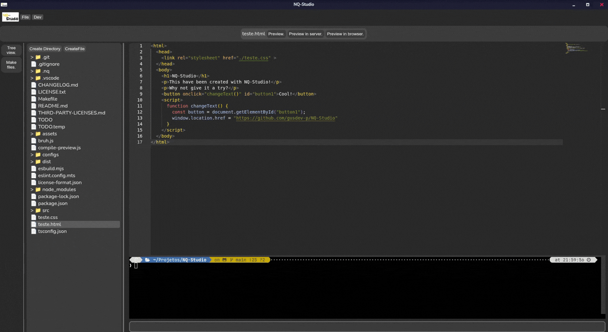

## NQ-Studio


<p align="center">
    
</p>

<p align="center">
<<<<<<< HEAD
    
    
    
=======
    
    
    
    
>>>>>>> 83cf12c (new update: 0.6.1-alpha)
</p>

<p align="center">
    A simple IDE/Code Editor for JavaScript, HTML, CSS and Node.js projects :0
</p>

<p align="center">
    <a href="https://nq-studio.pages.dev">
        🌐 Visit the NQ-Studio website
    </a>
</p>

<p align="center">
    
</p>

<p align="center">
    Tired of using a heavy IDE for a simple project? NQ-Studio is for you.
</p>


### Features ✨

- 💻 **Integrated Terminal** - You can execute your code without external terminals!
- 📂 **Tree View** - Much easier to see your files.
- ⚡ **Lightweight** - Lightweight compared to other IDEs.
- 🎨 **Dark, light and custom themes** - Fully customizable themes!
- 📝 **Monaco Editor** - Same editor that vs code uses!
- 📄 **Markdown Preview** - Preview of your `README.md`!
- 🖼️ **Image Preview** - Show your image with simple zoom and move.
- 🌐 **HTML Preview** - Preview in sidebar with toolbar.

### Current development state 🖥️

NQ-Studio is still under development, we don't recommend you use it for now, because some features are under development, like:

- properties tab for each file.
- `src` directory definition.

But if you don't mind that, you can use the IDE :)

### Changelog 🎯
NQ-Studio is now in the `0.6.0-alpha` version! To see the changes check: [CHANGELOG.md](./CHANGELOG.md)

--- 

### How to use the source code?

To use the NQ-Studio source code for what you want, you will need to execute some commands in your terminal:

```Bash
make install-deps
# or
npm install
```

This command installs all the dependencies that NQ-Studio needs to work, because the directory `node_modules` is not included in this project repository

```Bash
make 
# or
make all
```

This command executes other three steps:

- `make distclean` : Removes the `dist` directory, good for clean old builds.

- `make build` : Compiles all the TypeScript into JavaScript and copies essential files to the `dist` directory.

- `make preview` : Launches **Electron** and opens the IDE.

---

### Notes 📋
This project is under development and may contain bugs or have incomplete features.