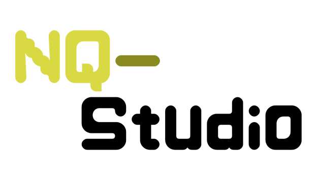
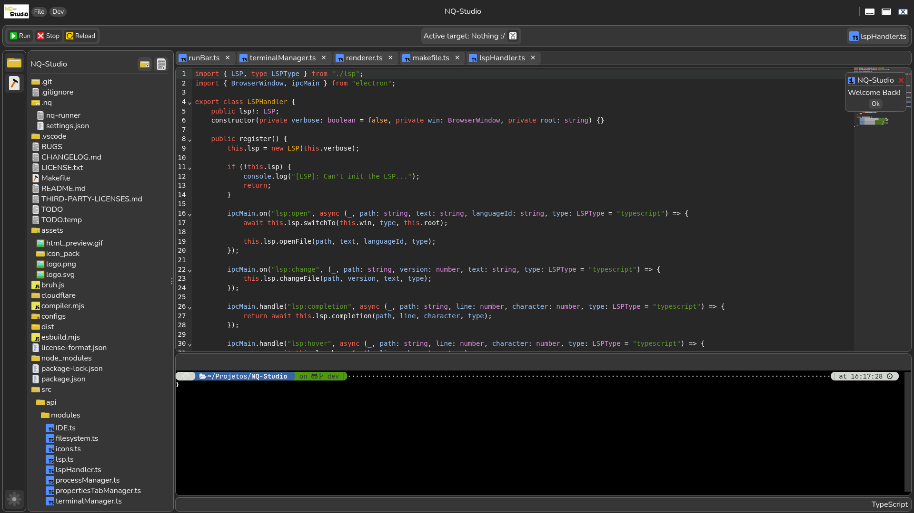

# NQ-Studio Development Branch

<p align="center">
    
</p>

<p align="center">
    
    
    
    
    
</p>

> ⚠️ Crashes and bugs are expected in this branch!

<p align="center">
    
</p>

## 🤔 Why this branch exists?

This bad boy here prevents the `main branch` exploding from a misspelled name or because is missing a comma.

So yeah, this branch MUST exists ;)

### 🏗️ Features?

Because this branch is like a "rolling version" of NQ-Studio here we have some features that aren't available in the `main` branch.

- `Run Bar` : You can easily execute your project or your code with just a button! Obviously it's under development...

- `Compilable` : With just a command with `make` or `npm`, you can compile the NQ-Studio to an AppImage or into a .deb

**### 💻 About the PRs (Pull Requests)**

All PRs are welcome! However, I have one simple requirement: **explain EVERYTHING you modified.**

I want to understand what you changed, why you changed it, and how it affects the project.

PRs without proper descriptions, or with descriptions that are too vague, will probably be rejected.

Here are some examples of what a good PR description should look like:

**❌ Bad PR description:**

```text
Fixed terminal.
```

Why? What was broken? What did you change? How did you fix it?

**✅ Good PR description:**

```md
## What changed?

- Fixed terminal resizing when the window changes its dimensions.
- Added a listener to update the terminal size automatically.

## Why?

Previously, the terminal wouldn't resize correctly when the application window was resized, causing text to wrap incorrectly.

## Files modified

- src/core/terminal/terminalManager.ts
- src/api/terminal.ts

## Additional notes

Tested on Debian Linux with ZSH.
```

**Another example:**

```md
## What changed?

- Added support for JSONC files in the editor.
- Updated the language detection system.

## Why?

JSONC files were previously being treated as regular JSON files, causing incorrect syntax highlighting.

## Files modified

- src/core/ui/renderer/nqEditor.ts
- src/core/languages/languageManager.ts
```

These are just examples, you don't have to follow this exact format. But please, give me enough information to understand your contribution!

If everything looks good, your PR will probably be merged into the `dev` branch. Once a new stable update is released, those changes may eventually make their way into the `main` branch.

### 📋 Contribution Guidelines

Before submitting a PR, please keep these rules in mind:

- **Don't submit generated files** unless explicitly required. Build artifacts and temporary files should stay out of the repository.
- **Keep the existing code style.** Consistency makes the code easier to read and maintain.
- **Test your changes before submitting.** Make sure your modifications actually work and don't introduce unexpected issues.
- **Don't silently remove existing functionality.** If something needs to be removed or replaced, explain why in your PR.
- **Keep your changes focused.** Avoid mixing unrelated modifications in a single PR.
- **Don't introduce unnecessary dependencies.** If you need a new package, explain why it's necessary.

These rules aren't here to make contributions harder. They're here to keep NQ-Studio maintainable and prevent the `dev` branch from becoming a complete mess. ;) 